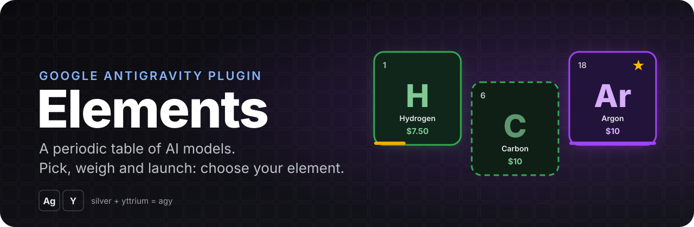
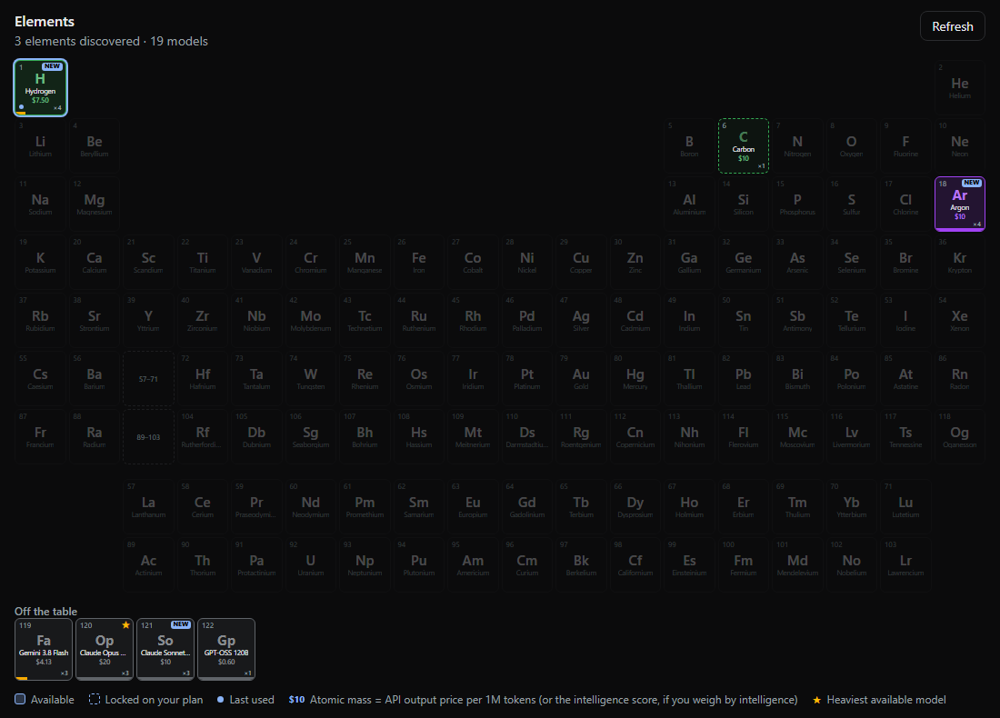
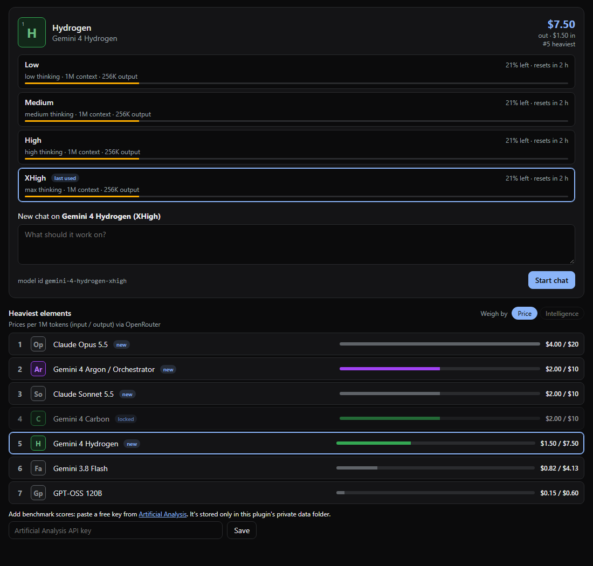

<div align="center">



<p>
  <a href="https://antigravity.google"></a>
  
  
</p>

<p>
  <a href="#install"><b>Install</b></a> ·
  <a href="#weighing"><b>Prices &amp; benchmarks</b></a> ·
  <a href="#limits"><b>Limits</b></a>
</p>

</div>

<br>

Google named its Gemini 4 models after elements, so **Elements** puts them on a real periodic table inside Antigravity. Hydrogen sits at **1**, Carbon at **6**, Argon at **18**. Every tier is one click away, and each tile's "atomic mass" is the model's live API price (or its benchmark score).

<p align="center">
  
</p>

---

## ⚗️ Properties

| | |
|---|---|
| **Atomic number** | Real. Element-named models land on their actual square. |
| **Atomic mass** | API output price per 1M tokens, pulled live, or the [Artificial Analysis](https://artificialanalysis.ai) Intelligence Index if you weigh by intelligence. |
| **★ Heaviest** | The heaviest model you can actually use right now, by whichever measure you picked. |
| **Isotopes** | Every tier of a model (Low, Medium, High, XHigh), with its thinking level, context window and output limit. |
| **Half-life** | Your remaining quota (the bar under each tile) and when it resets. |
| **Stability** | Dashed border: your plan locks this one. |
| **NEW** | Antigravity tagged it as new. |
| **Synthetic elements** | Models not named after an element (Flash, Claude, GPT-OSS) get made-up symbols in an "Off the table" row. |

## 🔬 Discovery

You don't need to update anything when a new element ships. Elements reads Antigravity's live model list and refreshes every 15 seconds while it's open (and again as soon as you switch back to it). If Google releases a model named after an element, it lights up on its square by itself.

<a id="weighing"></a>

## ⚖️ Weighing the elements

<p align="center">
  
</p>

Pick a tile to see each tier's quota, thinking level and token limits. Below that, **Heaviest elements** ranks every model family. Flip **Weigh by** between:

- **Price.** API price from [OpenRouter's public model list](https://openrouter.ai/api/v1/models), which needs no key and sends nothing about you. Cached for 6 hours. OpenRouter's rate can be a little above the provider's direct price. If it can't be reached, the bundled [`pricing.json`](sidecars/periodic_table/pricing.json) is used instead.
- **Intelligence.** The [Artificial Analysis](https://artificialanalysis.ai) Intelligence Index, a benchmark score. Each tier shows its own score where Artificial Analysis measured that exact tier, and the family is ranked by its best one.

### Adding benchmarks

Artificial Analysis needs a key, and the free one is enough.

1. Create a free key at [artificialanalysis.ai](https://artificialanalysis.ai/api-key-management-redirect).
2. Paste it into the box under the leaderboard and press **Save**.

The key is stored only in the plugin's private data folder inside Antigravity (`sidecar_data/`), never in the plugin folder, so it can't end up in a git commit. You can also set an `AA_API_KEY` environment variable instead. Scores are cached on disk for 12 hours, about 2 requests a day against the free tier's 100. **Remove key** deletes it.

Benchmark data © [Artificial Analysis](https://artificialanalysis.ai), shown with the attribution their API requires.

## 🧪 Reactions

Pick an isotope, type what you want done, hit **Start chat** (or Ctrl+Enter). Elements starts a new Antigravity conversation pinned to that exact model, using Antigravity's own `agentapi`, and opens it.

<a id="install"></a>

## 📦 Synthesis (install)

Clone it straight into Antigravity's plugin folder. The folder **must** be named `elements`:

**Windows (Command Prompt)**

```bat
git clone https://github.com/raylitebull/antigravity-elements "%USERPROFILE%\.gemini\config\plugins\elements"
```

**Windows (PowerShell)**

```powershell
git clone https://github.com/raylitebull/antigravity-elements "$env:USERPROFILE\.gemini\config\plugins\elements"
```

**macOS / Linux**

```bash
git clone https://github.com/raylitebull/antigravity-elements ~/.gemini/config/plugins/elements
```

You don't need to restart. Antigravity watches that folder and starts the plugin by itself. Then open **Elements** under **Extensions** in the left sidebar, or from the `+` menu in a conversation's header.

To update, run `git pull` in that folder.

> **Tip:** if `git clone` says the folder "already exists and is not empty", you already have a copy there. Delete or rename that `elements` folder first, then clone again.

<a id="limits"></a>

## 🧯 Lab safety (limits)

- **It starts new chats; it can't switch an open one.** Antigravity doesn't let plugins touch the model dropdown of an existing conversation.
- **Price isn't quality.** A higher price usually means a bigger model. Weigh by intelligence if you want a benchmark instead.
- **Benchmarks lag releases.** A brand-new model may have no Artificial Analysis score yet. It shows "–" until one appears.
- **Orchestrator (Argon)** has no public API price or benchmark of its own, so it's listed with Argon.
- Nothing is written to Antigravity's settings or state. The plugin only reads the model list and starts conversations through the official API. The only files it writes are its own key and benchmark cache.

## 🧬 Structure

```
elements/
├── plugin.json                  # Antigravity plugin manifest
├── assets/logo.svg
└── sidecars/periodic_table/
    ├── sidecar.json             # sidebar, full-pane and chat-pane views
    ├── main.mjs                 # backend: model list, prices, benchmarks, starting chats
    ├── pricing.json             # offline price fallback
    ├── elements.js              # the 118 elements
    ├── app.js · index.html · styles.css
```

---

<div align="center">
<sub><b>Ag</b> + <b>Y</b> = agy. Not affiliated with Google. Model names and prices belong to their owners.</sub>
</div>
